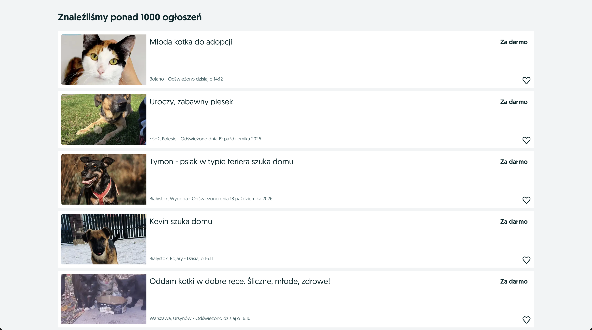
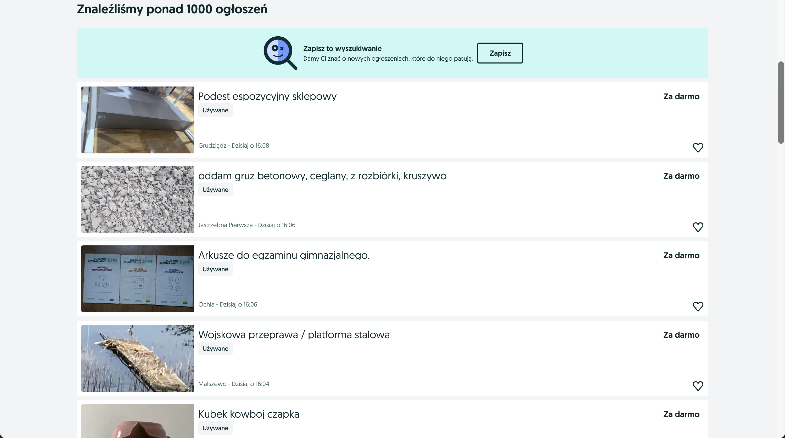

<p align="center">
  
</p>

<h1 align="center">Szperacz</h1>

<p align="center"><em>Szperaj tam, gdzie warto.</em></p>

<br>

Rozszerzenie do Chrome, które pozwala wybrać, jakie kategorie ogłoszeń widzisz w zakładce [OLX → Oddam za darmo](https://www.olx.pl/oddam-za-darmo/) — bo OLX nie daje tam żadnych filtrów. Odznaczasz np. **Zwierzęta** w popupie, a ich ogłoszenia znikają z listy, bez odświeżania strony.

<table>
  <tr>
    <td align="center"><b>Przed</b> — wszystkie kategorie</td>
    <td align="center"><b>Po</b> — „Zwierzęta” odznaczone</td>
  </tr>
  <tr>
    <td></td>
    <td></td>
  </tr>
</table>

## Wymagania

- **Chrome 105 lub nowszy** — filtr opiera się na CSS `:has()`, wspieranym od tej wersji,
- przeglądarka zgodna z rozszerzeniami Manifest V3.

## Instalacja (tryb deweloperski)

1. Pobierz i rozpakuj to repo.
2. Otwórz `chrome://extensions`.
3. Włącz **Tryb dewelopera** (prawy górny róg).
4. Kliknij **Załaduj rozpakowane** i wskaż rozpakowany folder.

Następnie kliknij ikonę rozszerzenia, odznacz „Zwierzęta” i wejdź na [https://www.olx.pl/oddam-za-darmo/](https://www.olx.pl/oddam-za-darmo/).

## Użycie

Kliknij ikonę rozszerzenia na pasku Chrome. W popupie:


- przełącznik w prawym górnym rogu włącza i wyłącza całe filtrowanie,
- **zaznaczona** kategoria jest pokazywana, **odznaczona** jest ukrywana,
- „Zaznacz wszystkie” pokazuje wszystko, „Odznacz wszystkie” ukrywa wszystkie znane kategorie,
- przełącznik „Ukryj etykiety «Wyróżnione»” (domyślnie włączony) usuwa plakietki „Wyróżnione” z listy, niezależnie od wybranych kategorii.

Domyślnie wszystkie kategorie są zaznaczone (widoczne), więc żeby coś ukryć — odznacz to w popupie.

Zmiany działają od razu, bez odświeżania strony. Ustawienia są zapamiętane w `chrome.storage.sync`, więc synchronizują się między Twoimi urządzeniami z Chrome.

<br clear="right">

## Prywatność

Szperacz nie wysyła żadnych zapytań sieciowych i nie zbiera żadnych danych. Całe filtrowanie dzieje się lokalnie w Twojej przeglądarce — jedyną rzeczą, którą rozszerzenie zapisuje, są Twoje własne ustawienia kategorii.

## Jak to działa

Każdy link do ogłoszenia na OLX zawiera ID kategorii głównej, np. `...-CID103-ID1cFG9C.html` (`CID103` = Zwierzęta). [`content.js`](content.js) buduje z odznaczonych w popupie ID regułę CSS i wstrzykuje ją na stronę:

```css
[data-cy="l-card"]:has(a[href*="-CID103-"]) { display: none }
```

Tym samym mechanizmem ukrywana jest warstwa etykiet „Wyróżnione” (`[data-olx-listing-item-badge-portal-root]`), jeśli przełącznik w popupie jest włączony. OLX przechodzi między stronami wyników bez przeładowania, a wstrzyknięty CSS od razu obejmuje nowo dołączone karty.

### Decyzje projektowe

- **Skrypt działa na całym `olx.pl`, a nie tylko na `/oddam-za-darmo/`.** Gdyby tak nie było, po wejściu na „Oddam za darmo” z innej podstrony OLX (bez pełnego przeładowania) skryptu by nie było i filtr nie działałby do odświeżenia karty. Sam filtr włącza się tylko wtedy, gdy adres zaczyna się od `/oddam-za-darmo/`, i reaguje na zmianę podstrony w locie.
- **Etykiety „Wyróżnione” można tylko ukryć wszystkie naraz.** OLX rysuje je w osobnej warstwie, w pozycjach liczonych z numeru karty na liście — nie da się ich powiązać z konkretną kartą, dlatego po ukryciu kart przy wyłączonym przełączniku zostają w pustych miejscach. Z tego powodu przełącznik jest domyślnie włączony.

## Znane ograniczenia

- Filtruje tylko kategorie główne. Ukrycie „Zwierząt” usuwa też akcesoria (np. „Buda dla psa”) i rośliny akwariowe. Na stronach sprawdzonych ręcznie 80 z 80 ukrytych to psy i koty.
- Strona dalej ładuje 52 ogłoszenia na stronę, więc po ukryciu zostaje ich mniej.
- Działa tylko na adresach zaczynających się od `/oddam-za-darmo/` — warianty z miastem lub frazą wyszukiwania (np. `/warszawa/oddam-za-darmo/`) są na roadmapie.
- Lista kategorii w popupie obejmuje te zaobserwowane w „Oddam za darmo”; nie ma tam np. Motoryzacji, bo takie ogłoszenia się nie pojawiły.
- Jeśli OLX zmieni atrybut `data-cy="l-card"` albo format adresu, filtr przestanie działać.
- Nazwa i logo nie zostały sprawdzone pod kątem dostępności w Chrome Web Store ani znaku towarowego.

## Roadmapa

- [ ] Adresy z miastem lub frazą wyszukiwania (np. `/warszawa/oddam-za-darmo/`) — dopisanie w `FREE_PATH` w [`content.js`](content.js) i przetestowanie
- [ ] Publikacja w Chrome Web Store

## Dla dewelopera

### Struktura projektu

```
manifest.json          konfiguracja rozszerzenia (Manifest V3)
content.js             ukrywa karty na stronie OLX
popup/                 popup z wyborem kategorii (HTML, CSS, JS)
icons/szperacz.svg     logo (źródło)
icons/szperacz-16.svg  uproszczona wersja logo pod 16 px
icons/icon*.png        ikony 16/48/128 wyrenderowane z SVG
screenshots/           zrzuty ekranu używane w README
LICENSE                licencja MIT
```

### Dodawanie kategorii

Znane kategorie:

| CID | Kategoria   | CID  | Kategoria         |
| --- | ----------- | ---- | ----------------- |
| 87  | Moda        | 751  | Książki i Muzyka  |
| 88  | Dla Dzieci  | 757  | Rolnictwo         |
| 99  | Elektronika | 767  | Sport i Hobby     |
| 103 | Zwierzęta   | 3647 | Zdrowie i Uroda   |
| 628 | Dom i Ogród | 4042 | Antyki i Kolekcje |
|     |             | 5216 | Budowa i Remont   |

Kolejną kategorię dopisujesz w `CATEGORIES` w [`popup/popup.js`](popup/popup.js) — ID znajdziesz w adresie ogłoszenia (fragment `-CID<liczba>-`).

### Workflow po zmianie kodu

Po zmianie kodu kliknij w `chrome://extensions` ikonę odświeżenia przy „Szperacz” i **raz** przeładuj już otwarte karty OLX. Chrome nie podmienia skryptu w kartach otwartych przed odświeżeniem rozszerzenia, więc stare karty przestają reagować na popup. Nowe karty i zmiany ustawień w popupie działają już bez przeładowania.

### Ikony

Ikony PNG odświeżysz z SVG: `rsvg-convert -w 128 -h 128 icons/szperacz.svg -o icons/icon128.png` (analogicznie 48 px z `szperacz.svg` i 16 px z `szperacz-16.svg`).

## Licencja

Projekt jest udostępniony na licencji [MIT](LICENSE) — możesz go swobodnie używać, kopiować i modyfikować, pod warunkiem zachowania informacji o autorze i treści licencji.

© 2026 Piotr Sieradzki
